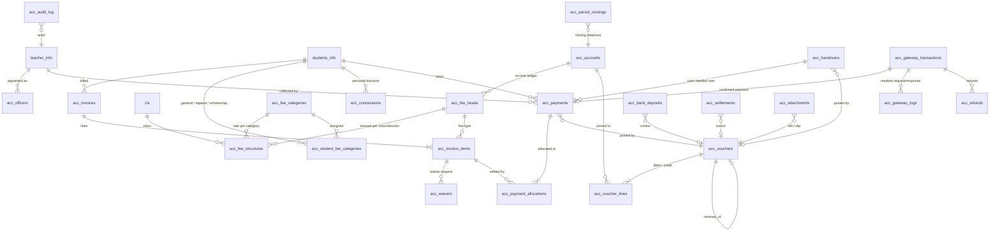

# স্কুল অ্যাকাউন্টিং ও ফি ম্যানেজমেন্ট সিস্টেম — নকশা প্রস্তাব

> সংস্করণ ১ (ধাপ ১-এর সাথে)। এই নথি `docs/` ফোল্ডারে থাকায় cPanel-এ ডিপ্লয় হয় না।

## ১. মূল নীতিমালা

| বিষয় | সিদ্ধান্ত |
|---|---|
| হিসাব পদ্ধতি | দ্বৈত-সত্তা (double-entry)। প্রতিটি ভাউচারে মোট ডেবিট = মোট ক্রেডিট, ডেটাবেসে সংরক্ষণের আগে সার্ভারে যাচাই। |
| আয় স্বীকৃতি | *Modified cash basis*: টাকা হাতে এলে (রসিদ/গেটওয়ে নিশ্চিত হলে) জেনারেল লেজারে আয় পোস্ট হয়। ইনভয়েস ও বকেয়া আলাদা "বিলিং সাব-লেজার"-এ থাকে, ফলে বকেয়া রিপোর্ট নির্ভুল থাকে কিন্তু লেজারে অনাদায়ী আয় ঢোকে না। দেশের অধিকাংশ বিদ্যালয়ের Receipts & Payments / I&E হিসাবের সাথে এটি সামঞ্জস্যপূর্ণ। |
| টাকার ধরন | ডেটাবেসে `DECIMAL(14,2)`, PHP-তে পূর্ণসংখ্যা **পয়সা** (int64) — কোথাও `float` নয়। ইনপুট `^\d{1,10}(\.\d{1,2})?$` রেগুলার এক্সপ্রেশনে কঠোরভাবে যাচাই। |
| মুছে ফেলা | কোনো আর্থিক টেবিলে `DELETE` নেই। ভুল সংশোধন = রিভার্সাল ভাউচার (`reversal_of_id`) + নতুন সঠিক এন্ট্রি। অনুমোদিত ভাউচার সম্পাদনা করা যায় না। |
| নম্বর | প্রতিটি ইনভয়েস/রসিদ/ভাউচার/হস্তান্তরের অনন্য ক্রমিক নম্বর, `acc_sequences` টেবিলে `SELECT … FOR UPDATE` লক দিয়ে বরাদ্দ — একসাথে দুই ব্যবহারকারী একই নম্বর পাবে না। |
| Idempotency | প্রতিটি পেমেন্ট ফর্মে একবার-ব্যবহারযোগ্য `idempotency_key` (UNIQUE)। দ্বিতীয়বার সাবমিট হলে নতুন রেকর্ড না হয়ে আগের রসিদটিই দেখায়। গেটওয়ে লেনদেনে `merchant_invoice_number`, `gateway_payment_id`, `trx_id` প্রতিটি UNIQUE। |
| গেটওয়ে যাচাই | কলব্যাক URL-এর প্যারামিটার শুধু "ইঙ্গিত"। সফলতা নিশ্চিত হয় কেবল সার্ভার থেকে Execute/Query API কলের উত্তরে। |
| অনুমোদন | অ্যাকাউন্টস অফিসারের ম্যানুয়াল ভাউচার, মওকুফ, রিফান্ড ও রিভার্সাল — প্রধান শিক্ষকের অনুমোদন না হওয়া পর্যন্ত লেজারে প্রভাব ফেলে না। |
| মাস সমাপনী | বন্ধ মাসে (closed period) কোনো পোস্টিং হবে না; শুধু প্রধান শিক্ষক কারণ লিখে মাস পুনরায় খুলতে পারবেন (অডিট লগসহ)। |
| অডিট | `acc_audit_log`-এ কে, কখন, কোন IP থেকে, কী করেছেন এবং **আগের ও পরের মান (JSON)**। পাসওয়ার্ড/টোকেন জাতীয় কী স্বয়ংক্রিয়ভাবে মাস্ক হয়। |
| গোপনীয়তা | শিক্ষার্থীর শুধু প্রয়োজনীয় পরিচিতি (id, নাম, শ্রেণী, রোল) ব্যবহার হয়; ওয়ালেট নম্বর মাস্ক করে (`017*****89`) রাখা হয়; কার্ড/পিন/OTP কখনো সংরক্ষণ নয়। |
| ক্রেডেনশিয়াল | bKash/Nagad-এর `app_key`, `app_secret`, `username`, `password` কেবল পাবলিক ফোল্ডারের বাইরের `bmlhs-private-config.php` (বা env) থেকে পড়া হবে। |

## ২. ভূমিকা ও অনুমতি (RBAC)

বিদ্যমান প্যানেল-রোল (`teacher_info.panel_role` = head/admin/teacher) ও শ্রেণী-শিক্ষক নিয়োগ (`class_teachers`) অপরিবর্তিত থাকে। হিসাব মডিউলের ভূমিকা এর উপর নির্ভর করে নির্ধারিত হয়:

| হিসাব-ভূমিকা | কীভাবে নির্ধারিত |
|---|---|
| প্রধান শিক্ষক / সুপার অ্যাডমিন | `panel_role = head` |
| অ্যাকাউন্টস অফিসার | `acc_officers`-এ সক্রিয় নিয়োগ (প্রধান শিক্ষক নিয়োগ/প্রত্যাহার করেন, ইতিহাস সংরক্ষিত) |
| শ্রেণী শিক্ষক | চলতি সেশনের `class_teachers` নিয়োগ — শুধু নিজ শ্রেণী/শাখা |
| (ঐচ্ছিক) অভিভাবক পোর্টাল | ধাপ ৫-এ: শিক্ষার্থী আইডি + অভিভাবকের মোবাইলে OTP; শুধু নিজের ইনভয়েস দেখা ও অনলাইন পেমেন্ট |

একজন শিক্ষক একই সাথে অ্যাকাউন্টস অফিসার ও শ্রেণী শিক্ষক হলে উভয় ভূমিকার অনুমতি একত্রে পাবেন।

| অনুমতি (capability) | প্রধান | অফিসার | শ্রেণী শিক্ষক |
|---|:-:|:-:|:-:|
| ড্যাশবোর্ড দেখা | ✔ | ✔ | ✔ (নিজ শ্রেণী) |
| অফিসার নিয়োগ/প্রত্যাহার | ✔ | | |
| ফি কাঠামো ও চার্ট অব অ্যাকাউন্টস | ✔ | | |
| সব শিক্ষার্থীর ফি/বকেয়া দেখা | ✔ | ✔ | |
| নিজ শ্রেণীর ফি/বকেয়া দেখা | ✔ | ✔ | ✔ |
| ফি আদায় ও রসিদ | ✔ | ✔ | ✔ (নিজ শ্রেণী) |
| মওকুফ/ছাড়ের আবেদন | ✔ | ✔ | ✔ |
| মওকুফ/ছাড় অনুমোদন | ✔ | | |
| আদায়কৃত টাকা হস্তান্তর জমা | | | ✔ |
| হস্তান্তর গ্রহণ | ✔ | ✔ | |
| আয়-ব্যয় ভাউচার তৈরি | ✔ | ✔ | |
| ভাউচার/রিভার্সাল অনুমোদন | ✔ | | |
| ব্যাংক জমা যাচাই ও রিকনসিলিয়েশন | ✔ | ✔ | |
| গেটওয়ে সেটিংস (চার্জ কে বহন করবে ইত্যাদি) | ✔ | | |
| রিফান্ড আবেদন | ✔ | ✔ | |
| রিফান্ড অনুমোদন | ✔ | | |
| সব রিপোর্ট | ✔ | ✔ | |
| নিজ শ্রেণীর আদায় ও বকেয়া রিপোর্ট | ✔ | ✔ | ✔ |
| মাস সমাপনী/পুনরায় খোলা | ✔ | | |
| হিসাব অডিট লগ | ✔ | | |

অনুমতির একমাত্র উৎস `School\Accounting\Access\Capability::MATRIX`; প্রতিটি পেজ ও প্রতিটি POST অ্যাকশন সার্ভারে `AccessContext::can()` / `canForClass()` দিয়ে যাচাই করে। মেনু লুকানো কেবল সুবিধার জন্য, নিরাপত্তার জন্য নয়।

## ৩. ER ডায়াগ্রাম



## ৪. টেবিল বিবরণ

সব টেবিল InnoDB, utf8mb4। `acc_` টেবিলগুলোর মধ্যে Foreign key থাকবে; বিদ্যমান টেবিলে (`students_info`, `teacher_info`, `cls`, `sections`) কেবল ইনডেক্সড id রেফারেন্স (পুরোনো ডেটার সাথে সংঘাত এড়াতে)। শিক্ষার্থীর শ্রেণী/শাখা/সেশন/রোল ইনভয়েসে *snapshot* হিসেবে রাখা হয়, যাতে পরবর্তী প্রমোশনে পুরোনো হিসাব বদলে না যায়।

### ধাপ ১ (এই PR-এ তৈরি)

**acc_officers** — অ্যাকাউন্টস অফিসার নিয়োগের ইতিহাস
`id, teacher_id, is_active, appointed_by, appointed_at, appointment_note, revoked_by, revoked_at, revoke_reason` ; একই শিক্ষকের একাধিক সক্রিয় নিয়োগ রোধে `active_teacher_id` (সক্রিয় হলে teacher_id, নইলে NULL) কলামে UNIQUE।

**acc_audit_log** — অপরিবর্তনীয় অডিট
`id, actor_id, actor_name, actor_role, action, entity_type, entity_id, before_json, after_json, note, ip_address, created_at`

### পরবর্তী ধাপের টেবিল

| টেবিল | মূল কলাম | মূল সীমাবদ্ধতা |
|---|---|---|
| `acc_settings` | `setting_key, setting_value, updated_by` | key UNIQUE |
| `acc_sequences` | `seq_key, period, next_no` | PK(seq_key, period) |
| `acc_accounts` (চার্ট অব অ্যাকাউন্টস) | `code, name_bn, name_en, account_type`(asset/liability/income/expense/fund)`, parent_id, money_kind`(cash/bank/bkash/nagad/teacher_custody/none)`, is_system, is_active` | code UNIQUE; সিস্টেম হিসাব নিষ্ক্রিয় করা যাবে না |
| `acc_fee_heads` | `code, name_bn, category`(monthly/session/admission/exam/other)`, income_account_id, late_fine_allowed, is_active` | code UNIQUE |
| `acc_fee_categories` | `code`(general/stipend/scholarship …)`, name_bn, is_default, requires_reference, sort_order, is_active` | code UNIQUE; ঠিক একটি `is_default` (সাধারণ) |
| `acc_student_fee_categories` | `student_id, session_year, fee_category_id, reference_no`(উপবৃত্তি/বৃত্তির আদেশ নং)`, effective_from, effective_to, status`(pending/approved/ended)`, requested_by, approved_by, approved_at, note` | একই শিক্ষার্থীর একই সময়ে একটির বেশি অনুমোদিত শ্রেণী নয় |
| `acc_fee_structures` | `fee_head_id, session_year, class_id, section_id`(0=পুরো শ্রেণী)`, fee_category_id, amount, due_day, late_fine_amount, grace_days, effective_from, is_active` | UNIQUE(fee_head, session, class, section, fee_category, effective_from) |
| `acc_concessions` | `student_id, fee_head_id, session_year, kind`(percent/fixed)`, value, reason, status, requested_by, approved_by, approved_at` | অনুমোদিত হলেই প্রয়োগ |
| `acc_invoices` | `invoice_no, student_id, session_year, class_id, section_id, roll_snapshot, name_snapshot, billing_period`(YYYY-MM বা exam-id)`, issue_date, due_date, gross, discount, fine, waived, net, paid, status`(unpaid/partial/paid/waived/cancelled) | invoice_no UNIQUE; UNIQUE(student_id, billing_period) — একই মাসের বিল দুবার হবে না |
| `acc_invoice_items` | `invoice_id, fee_head_id, line_kind`(fee/late_fine)`, fee_category_id, standard_amount`(সাধারণ হার)`, category_concession`(সাধারণ হার − শ্রেণীর হার)`, amount, discount, waived, net, paid` | UNIQUE(invoice_id, fee_head_id, line_kind) |
| `acc_waivers` | `invoice_item_id, amount, reason, status`(pending/approved/rejected)`, requested_by, decided_by, decided_at` | — |
| `acc_payments` | `receipt_no, idempotency_key, student_id, amount, method`(cash/bkash/nagad/bank)`, status`(confirmed/reversed)`, custody`(teacher/office/gateway/bank)`, collected_by, collected_at, handover_id, gateway_txn_id, voucher_id, reversal_voucher_id, note` | receipt_no, idempotency_key, gateway_txn_id UNIQUE |
| `acc_payment_allocations` | `payment_id, invoice_item_id`(NULL = অগ্রিম)`, amount` | অবশিষ্ট টাকা "অগ্রিম ফি" দায় হিসেবে থাকে, পরের ইনভয়েসে স্বয়ংক্রিয় সমন্বয় |
| `acc_handovers` | `handover_no, teacher_id, total, payment_count, status`(submitted/received/rejected)`, submitted_at, received_by, received_at, remark, voucher_id` | একটি পেমেন্ট শুধু একটি সক্রিয় হস্তান্তরে |
| `acc_vouchers` | `voucher_no, voucher_type`(receipt/payment/journal/contra)`, voucher_date, narration, total, status`(draft/submitted/approved/rejected)`, source_type, source_id, created_by, approved_by, approved_at, reversal_of_id, reversed_by_id` | voucher_no UNIQUE; অনুমোদিত হলে অপরিবর্তনীয় |
| `acc_voucher_lines` | `voucher_id, account_id, debit, credit, party_type, party_id`(student/teacher)`, memo` | CHECK একটি পক্ষ শূন্য; সার্ভারে ∑Dr = ∑Cr |
| `acc_attachments` | `owner_type, owner_id, stored_name, original_name, mime, size_bytes, sha256, uploaded_by` | ফাইল পাবলিক ফোল্ডারের বাইরে `bmlhs-private-media/accounts/`; শুধু PDF/JPG/PNG/WebP, ≤ ৫ MB, MIME `finfo` দিয়ে যাচাই |
| `acc_gateway_transactions` | `gateway, merchant_invoice_number, invoice_id, student_id, amount, charge_amount, charge_bearer`(school/payer)`, payable_amount, status`(initiated/pending/success/failed/cancelled/expired/refunded/partially_refunded)`, gateway_payment_id, trx_id, payer_reference_masked, initiated_by, verified_at, last_queried_at, query_attempts` | merchant_invoice_number, (gateway, gateway_payment_id), (gateway, trx_id) UNIQUE |
| `acc_gateway_logs` | `gateway_txn_id, operation`(grant/refresh/create/execute/query/refund/search)`, http_status, request_masked, response_masked, error, duration_ms, created_at` | append-only |
| `acc_refunds` | `gateway_txn_id, amount, reason, status, refund_trx_id, requested_by, approved_by, voucher_id` | মোট রিফান্ড ≤ মূল পরিমাণ |
| `acc_bank_deposits` | `bank_account_id, deposit_date, amount, slip_no, status`(pending/verified/rejected)`, deposited_by, verified_by, voucher_id` | — |
| `acc_settlements` | `gateway, settlement_date, gross, charge, net, bank_account_id, bank_reference, status, voucher_id` | — |
| `acc_period_closings` | `period`(YYYY-MM)`, status`(closed/reopened)`, closed_by, closed_at, reopened_by, reopen_reason, balances_json` | period UNIQUE |

### শিক্ষার্থীর ফি-শ্রেণী: সাধারণ বনাম বৃত্তি/উপবৃত্তিপ্রাপ্ত (ধাপ ২)

সাধারণ শিক্ষার্থী এবং বৃত্তি/উপবৃত্তিপ্রাপ্ত শিক্ষার্থীর বেতন আলাদা হবে।

* **ফি-শ্রেণী (`acc_fee_categories`)** — ডিফল্ট: *সাধারণ* (default), *উপবৃত্তিপ্রাপ্ত*, *বৃত্তিপ্রাপ্ত*। প্রধান শিক্ষক নতুন শ্রেণী (যেমন অর্ধ-বেতন, পূর্ণ ফ্রি) যোগ বা নিষ্ক্রিয় করতে পারবেন; মুছে ফেলা যাবে না।
* **হার নির্ধারণ** — ফি কাঠামোতে প্রতিটি ফি হেড × শ্রেণী/শাখা × সেশনের জন্য প্রতিটি ফি-শ্রেণীর আলাদা পরিমাণ (যেমন ৬ষ্ঠ শ্রেণীর মাসিক বেতন: সাধারণ ৳২০০, উপবৃত্তিপ্রাপ্ত ৳১০০, বৃত্তিপ্রাপ্ত ৳০)। কোনো ফি-শ্রেণীর আলাদা হার না দিলে *সাধারণ* হার প্রযোজ্য — ফলে শুধু যে ফি হেডে পার্থক্য আছে (সাধারণত মাসিক বেতন), সেখানেই আলাদা হার দিতে হবে; পরীক্ষা/সেশন ফি চাইলে সবার জন্য এক থাকবে।
* **শিক্ষার্থী নির্ধারণ** — অফিসার বা শ্রেণী শিক্ষক (নিজ শ্রেণী) উপবৃত্তি/বৃত্তির আদেশ নম্বরসহ আবেদন করবেন, প্রধান শিক্ষক অনুমোদন করলে কার্যকর। কার্যকর তারিখ থেকে পরবর্তী ইনভয়েসে নতুন হার; আগের ইনভয়েস বদলায় না (প্রয়োজনে মওকুফ-প্রবাহে সমন্বয়)। শ্রেণী না থাকলে শিক্ষার্থী *সাধারণ*। তালিকা থেকে একসাথে অনেক শিক্ষার্থী নির্ধারণের সুবিধা থাকবে।
* **ইনভয়েস** — প্রতিটি লাইনে প্রযোজ্য ফি-শ্রেণী, সাধারণ হার ও শ্রেণীজনিত ছাড় snapshot হিসেবে থাকে। ফলে রিপোর্টে "উপবৃত্তি/বৃত্তিজনিত মোট ছাড়" এবং ফি-শ্রেণীভিত্তিক আদায়/বকেয়া আলাদা দেখা যাবে।
* **ব্যক্তিগত ছাড়** (`acc_concessions`) ফি-শ্রেণীর হারের উপর আলাদাভাবে প্রয়োগ হয় — বিশেষ ক্ষেত্রে (ভাইবোন ছাড়, দরিদ্র তহবিল ইত্যাদি)।
* **হিসাব** — modified cash basis অনুযায়ী ফি-শ্রেণীর ছাড় আয় হিসেবে লেজারে যায় না; শুধু বিলিং সাব-লেজার ও রিপোর্টে দেখায়।

### ডিফল্ট চার্ট অব অ্যাকাউন্টস (ধাপ ৪-এ seed)

| কোড | হিসাব | ধরন |
|---|---|---|
| 1110 | নগদ তহবিল (অফিস) | সম্পদ/cash |
| 1120 | শিক্ষকের কাছে অনিষ্পন্ন আদায় | সম্পদ/teacher_custody |
| 1130 | bKash মার্চেন্ট হিসাব | সম্পদ/bkash |
| 1140 | Nagad মার্চেন্ট হিসাব | সম্পদ/nagad |
| 1150 | ব্যাংক হিসাব (প্রতিটি ব্যাংক আলাদা উপ-হিসাব) | সম্পদ/bank |
| 2110 | অগ্রিম প্রাপ্ত ফি | দায় |
| 2120 | রিফান্ড প্রদেয় | দায় |
| 3100 | সাধারণ তহবিল | তহবিল |
| 4110–4190 | মাসিক বেতন, ভর্তি/সেশন, পরীক্ষা, বিলম্ব জরিমানা, অন্যান্য ফি | আয় |
| 4200–4400 | সরকারি অনুদান, দান, ব্যাংক সুদ | আয় |
| 5110–5190 | বেতন/সম্মানী, বিদ্যুৎ-পানি, মুদ্রণ-স্টেশনারি, পরীক্ষা, মেরামত, বিবিধ | ব্যয় |
| 5160 | গেটওয়ে চার্জ | ব্যয় |
| 5170 | ব্যাংক চার্জ | ব্যয় |

### স্বয়ংক্রিয় পোস্টিং নিয়ম

| ঘটনা | ডেবিট | ক্রেডিট |
|---|---|---|
| শ্রেণী শিক্ষক নগদ আদায় করলেন | 1120 শিক্ষকের কাছে (party = শিক্ষক) | সংশ্লিষ্ট ফি-আয় / 2110 অগ্রিম |
| অফিসার হস্তান্তর গ্রহণ করলেন | 1110 নগদ | 1120 শিক্ষকের কাছে |
| অফিসে সরাসরি নগদ আদায় | 1110 নগদ | ফি-আয় |
| bKash সফল (চার্জ স্কুল বহন করে) | 1130 bKash (নিট) + 5160 গেটওয়ে চার্জ | ফি-আয় (পূর্ণ ফি) |
| bKash সফল (চার্জ অভিভাবক বহন করে) | 1130 bKash (ফি পরিমাণ) | ফি-আয়; অতিরিক্ত চার্জ আলাদা কলামে দেখানো হবে, আয় নয় |
| ব্যাংকে জমা | 1150 ব্যাংক | 1110 নগদ (Contra) |
| গেটওয়ে সেটেলমেন্ট | 1150 ব্যাংক | 1130 bKash / 1140 Nagad (Contra) |
| রিফান্ড অনুমোদিত | ফি-আয় | 1130 bKash |
| ভুল সংশোধন | মূল ভাউচারের উল্টো লাইন (Reversal) | — |

গেটওয়ে চার্জের প্রকৃত হার ও কখন কাটা হয়, তা মার্চেন্ট চুক্তি ও সেটেলমেন্ট রিপোর্ট দেখে কনফিগ করা হবে; কোডে অনুমান করা হবে না।

## ৫. ফোল্ডার কাঠামো

```
shared/Accounting/                 ← হিসাব মডিউলের সব ব্যবসায়িক লজিক (ওয়েব থেকে সরাসরি অ্যাক্সেস নিষিদ্ধ, .htaccess)
├── bootstrap.php                  ← PSR-4 অটোলোডার (School\Accounting\ → src/), schema, হেল্পার
├── schema.php                     ← acc_ টেবিলের ভার্সনভিত্তিক মাইগ্রেশন
├── functions.php                  ← পেজের জন্য ছোট প্রসিডিউরাল হেল্পার (accAccess(), accRequire() …)
├── cron/
│   └── reconcile-pending.php      ← (ধাপ ৫) শুধু CLI: পেন্ডিং গেটওয়ে লেনদেন Query করে মেলানো
└── src/                           ← PSR-4, PSR-12 কোডিং স্টাইল
    ├── Access/                    ← Role, Capability, AccessContext, AccessContextFactory, OfficerRepository
    ├── Audit/                     ← AuditTrail (আগের/পরের মান, মাস্কিং)
    ├── Support/                   ← Money (পয়সা), BanglaFormat, AmountInWords, Sequence  (ধাপ ২–৩)
    ├── Billing/                   ← FeeHead, FeeStructure, InvoiceGenerator, ConcessionService (ধাপ ২)
    ├── Collection/                ← PaymentService, ReceiptService, HandoverService (ধাপ ৩)
    ├── Ledger/                    ← ChartOfAccounts, VoucherService, PostingRules, PeriodClosing (ধাপ ৪)
    ├── Gateway/                   ← PaymentGatewayInterface, GatewayResult, GatewayHttpClient,
    │                                 Bkash/BkashTokenizedGateway, Nagad/NagadGateway (adapter stub) (ধাপ ৫)
    └── Report/                    ← ReportService, Workbook (SpreadsheetML), ReportPdf (ধাপ ৬)

dist/pages/accounts/               ← অ্যাডমিন প্যানেলের পাতলা পেজ (শুধু ইনপুট যাচাই → সার্ভিস কল → ভিউ)
├── dashboard.php                  ← (ধাপ ১) ভূমিকা অনুযায়ী ড্যাশবোর্ড
├── officers.php                   ← (ধাপ ১) অফিসার নিয়োগ/প্রত্যাহার
├── audit.php                      ← (ধাপ ১) আগের/পরের মানসহ অডিট লগ
├── fee-heads.php, fee-structure.php, invoices.php, dues.php            (ধাপ ২)
├── collect.php, receipt.php, handovers.php                             (ধাপ ৩)
├── chart-of-accounts.php, vouchers.php, voucher-print.php, bank.php    (ধাপ ৪)
├── gateway-settings.php, gateway-transactions.php                      (ধাপ ৫)
└── reports.php                                                         (ধাপ ৬)

bmlhs/fee-payment.php               ← (ধাপ ৫) অভিভাবক পোর্টাল
bmlhs/fee-payment-callback.php     ← bKash কলব্যাক (URL প্যারামিটার শুধু ইঙ্গিত)
bmlhs/fee-payment-result.php       ← ফলাফল
bmlhs/fee-receipt.php              ← অভিভাবকের রসিদ
dist/pages/accounts/online-payments.php, refunds.php, settlements.php
dist/cron/accounting-gateway.php   ← প্রতি ৫ মিনিট; পেন্ডিং পেমেন্ট ও অনিশ্চিত রিফান্ড
tests/unit/accounting-*.test.php   ← ইউনিট টেস্ট (ডিপ্লয় হয় না)
docs/accounting/                   ← নকশা, ব্যবহার নির্দেশিকা, টেস্ট প্ল্যান (ডিপ্লয় হয় না)
<public_html-এর বাইরে>/bmlhs-private-config.php   ← গেটওয়ে ক্রেডেনশিয়াল
```

## ৬. গেটওয়ে নকশা (ধাপ ৫-এ বাস্তবায়ন)

```php
interface PaymentGatewayInterface
{
    public function code(): string;                                   // 'bkash', 'nagad'
    public function createPayment(PaymentRequest $request): GatewayResult;  // redirect URL দেয়
    public function confirmPayment(string $gatewayPaymentId): GatewayResult; // Execute (bKash) — সার্ভার থেকে
    public function queryPayment(string $gatewayPaymentId): GatewayResult;   // Query/Status — cron ও পুনর্যাচাই
    public function refund(RefundRequest $request): GatewayResult;
}
```

* **bKash Tokenized Checkout**: Grant Token → Create Payment → (গ্রাহক bKash পেজে অনুমোদন) → কলব্যাক → সার্ভার থেকে Execute → Execute অস্পষ্ট/টাইমআউট হলে Query → সফল হলে একটি ডাটাবেস ট্রানজাকশনে পেমেন্ট + বরাদ্দ + ভাউচার। Refund আলাদা অনুমোদন-প্রবাহে। প্রতিটি endpoint, হেডার ও ফিল্ডের নাম ধাপ ৫-এ developer.bka.sh-এর অফিসিয়াল ডকুমেন্টেশন ও sandbox ক্রেডেনশিয়াল দিয়ে মিলিয়ে লেখা হবে — অনুমানে নয়।
* **Nagad**: অফিসিয়াল মার্চেন্ট ডকুমেন্টেশন ও sandbox অ্যাক্সেস না পাওয়া পর্যন্ত `NagadGateway` শুধু adapter কাঠামো থাকবে এবং "সক্রিয় নয়" ত্রুটি দেবে।
* HTTP: cURL, `CURLOPT_TIMEOUT = 30`, `CURLOPT_SSL_VERIFYPEER = true`, `CURLOPT_SSL_VERIFYHOST = 2`।
* লগ: প্রতিটি রিকোয়েস্ট/রেসপন্স `acc_gateway_logs`-এ; `app_key, app_secret, username, password, id_token, refresh_token, Authorization`, ওয়ালেট নম্বর মাস্ক।
* অবস্থা: `initiated → pending → success | failed | cancelled | expired`; `success → refunded/partially_refunded`। কলব্যাকের `status=success` দেখে কখনো `success` করা হয় না।
* Cron (প্রতি ৫ মিনিট, CLI): নির্দিষ্ট সময়ের বেশি `initiated/pending` থাকা লেনদেন Query করে অবস্থা মেলায়।

## ৭. বাস্তবায়নের ধাপ

| ধাপ | বিষয় | অবস্থা |
|---|---|---|
| ০ | নকশা প্রস্তাব (এই নথি) | ✔ |
| ১ | অথেন্টিকেশন ও ভূমিকা: হিসাব-ভূমিকা, অনুমতি ম্যাট্রিক্স, অফিসার নিয়োগ/প্রত্যাহার, before/after অডিট, মেনু, ড্যাশবোর্ড কাঠামো | ✔ এই PR |
| ২ | ফি হেড, ফি-শ্রেণী (সাধারণ/উপবৃত্তি/বৃত্তি) অনুযায়ী আলাদা হারসহ শ্রেণীভিত্তিক ফি কাঠামো, ব্যক্তিগত ছাড়, স্বয়ংক্রিয় ইনভয়েস, বকেয়া তালিকা | ✔ বিলম্ব জরিমানা পরে তুলে দেওয়া হয়েছে |
| ৩ | নগদ আদায়, ক্রমিক রসিদ (প্রিন্ট/SMS), আংশিক ও অগ্রিম পেমেন্ট, শিক্ষক → অফিসার হস্তান্তর | ✔ |
| ৪ | চার্ট অব অ্যাকাউন্টস, Receipt/Payment/Journal/Contra ভাউচার, অনুমোদন, রিভার্সাল, সংযুক্তি, ব্যাংক জমা, মাস সমাপনী | ✔ |
| ৫ | bKash Tokenized Checkout v2 (sandbox), Nagad adapter (ডকুমেন্টেশন ছাড়া নিষ্ক্রিয়), অভিভাবক পোর্টাল, cron, রিফান্ড, সেটেলমেন্ট | ✔ |
| ৬ | রিপোর্ট (PDF/Excel) ও চার্টসহ ড্যাশবোর্ড | সম্পন্ন — `ReportService` (ট্রায়াল, আয়-ব্যয়, নগদ/ব্যাংক/গেটওয়ে, আদায়, বকেয়া, ছাড়), `reports.php`, SpreadsheetML ও বাংলা PDF, ড্যাশবোর্ডে Chart.js |
| ৭ | নিরাপত্তা যাচাই, টেস্ট প্ল্যান, sandbox → live চেকলিস্ট, ব্যবহার নির্দেশিকা | সম্পন্ন — `02` থেকে `07` নথি। কোড রিভিউ; তৃতীয় পক্ষের অডিট নয়। স্যান্ডবক্স ক্রেডেনশিয়াল দিয়ে প্রথম আসল পেমেন্ট এখনো বাকি |

ধাপ ৭-এর নথি: [নিরাপত্তা যাচাই](02-security-review.md), [টেস্ট প্ল্যান](03-test-plan.md), [sandbox থেকে live](04-sandbox-to-live.md), [প্রধান শিক্ষক](05-guide-head.md), [অ্যাকাউন্টস অফিসার](06-guide-officer.md), [শ্রেণী শিক্ষক](07-guide-teacher.md)। এগুলো `docs/`-এ থাকায় ওয়েবসাইটে ওঠে না।

ধাপ ৫-এ কলব্যাকের `status` কখনো চূড়ান্ত নয়: সফলতার আগে সার্ভার Execute বা Query করে। একই লেনদেনে Execute একবার, প্রতিটি ইনভয়েস নম্বর ও idempotency key অনন্য। গেটওয়ে চার্জ অভিভাবক বহন করলে আদায়ের সঙ্গে ৫১৬০-এ আলাদা (আয় নয়); স্কুল বহন করলে সেটেলমেন্টের সময় খরচ হয়। ক্রেডেনশিয়াল শুধু প্রাইভেট কনফিগ `payment_gateways.bkash` বা `BMLHS_BKASH_*` এনভ্যারনমেন্টে। কলব্যাকের ভিত্তি ঠিকানা `payment_callback_base` দিয়ে Host হেডারের বাইরে রাখা যায়। Nagad-এর অফিসিয়াল ডকুমেন্টেশন না আসা পর্যন্ত `NagadGateway` কোনো অনুরোধ পাঠায় না।
